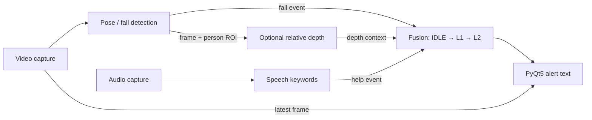

# Jetson Multimodal Emergency Detection

A university team research prototype exploring how pose-based fall events,
speech help keywords, and relative depth can provide complementary context for
an alert. Multiprocessing workers feed a fusion state machine and a PyQt5
monitoring window. Depth describes the person's relative proximity within a
scene; it is not distance in meters or reconstructed 3D position.

The original project was **AI-based 3D Robot Sensing — Jetson Nano (Final
Project)**. This repository preserves the team's application with scoped
integration fixes, explicit runtime health, and a reproducible synthetic demo.

## Team contributions

Historical documentation and source comments support these responsibilities:

| Contributor | Original responsibility |
| --- | --- |
| SU | Relative depth estimation, Depth Anything V2 integration, person ROI processing, pose-to-depth handoff |
| SONG | Pose estimation, multiperson tracking, fall detection |
| HUO | Speech features, recognition, help-keyword detection |
| Martin | Fusion state machine, PyQt5 UI, main application integration |

Capture, messaging, GPU coordination, streaming glue, and integration utilities
are shared team components. [Provenance](docs/PROVENANCE.md) preserves the
original 35-file inventory and source hashes without inventing individual
commit history or exclusive authorship of the application.

## How the modalities combine



A confirmed `lay_down` event enters L1. A recognized help keyword with
confidence at least 0.50 can escalate to L2 when it follows the fall by at most
10 seconds. Depth and camera-frame region enrich the alert text; depth is not
required for escalation. Duplicate falls preserve severity and the original
escalation window. Alerts expire after more than 30 seconds without qualifying
activity, and can be reset manually.

Workers keep capture and inference separate from the main process's fusion and
UI updates. Synthetic mode has five child processes: video, audio, gesture,
depth, and speech. Hardware mode has four: video, audio, speech, and a merged
GPU worker that runs pose and optional depth sequentially. Sharing one CUDA
process was a memory-saving decision for the constrained Jetson Nano; depth
can pause pose processing. See [Architecture](docs/ARCHITECTURE.md) for queue
contracts, health states, and remaining timing limitations.

## Reproducible synthetic demo

From the repository root, use Python 3.10–3.12 on a PC. The headless checks need
no sensors, model weights, CUDA, TensorRT, Qt, or display:

```bash
python3 -m venv .venv
source .venv/bin/activate
python -m pip install -r requirements-dev.txt
python -m pytest -q
python -m tests.test_fusion
python -m tests.smoke_sim
```

The current suite has **132 tests** covering fusion, queues, packet validation,
mocked sensor/model failures and recovery, health reporting, and worker cleanup.
The 16-second smoke runs all five synthetic workers, observes L1 then L2, and
checks their shutdown. These verify software behavior, not model accuracy or
inference performance. [Testing](docs/TESTING.md) records commands and evidence.

For the desktop GUI and optional offscreen check:

```bash
python -m pip install -r requirements-ui.txt
python main.py --sim
# Or validate the existing GUI without a display:
QT_QPA_PLATFORM=offscreen python -m tests.gui_sim
```

The scripted 45-second scene falls at 10 seconds and emits help at 13 seconds.
**F/H** force synthetic fall/help; **R** resets the alert and scenario. F/H do
not inject hardware detections. The window shows video, boxes, relative depth,
backend health, and alert text. It implements no geographic map, SMS delivery,
or emergency dispatch.

## Hardware and models

The historical target was Jetson Nano, JetPack 4.6.x, Python 3.6.9, CUDA 10.2,
and a compatible NVIDIA PyTorch build. Modern PC requirement files are not a
Jetson specification. Real mode needs a camera, microphone, OpenCV,
PyAudio/PortAudio, platform PyQt5, PyTorch/torchvision, `trt_pose`, `torch2trt`,
and trusted local pose and speech checkpoints. Optional depth needs the external
Depth Anything V2 framework and Small checkpoint; Vosk is an optional speech
fallback. [Setup](docs/SETUP.md) and [Models](docs/MODELS.md) describe the exact
historical paths, dependencies, loading limitations, and artifact rights.

```bash
# After manually preparing the hardware dependencies and trusted models:
python3 main.py                  # pose + speech; depth disabled
python3 main.py --depth          # optional relative depth
python3 test_console.py 60       # hardware console without Qt
```

No checkpoints, training data, recordings, or generated TensorRT artifacts are
distributed. Historical model identity and redistribution rights remain
unverified; framework licenses do not establish a particular model's rights.

## Runtime health

The UI separates worker heartbeats from backend health: `READY`, `SIMULATION`,
`DEGRADED`, `UNAVAILABLE`, `DISABLED`, `INITIALIZING`, and `STALE`. Real capture
failures produce no fabricated observations; device retries follow reported
read/open errors. Failed model initialization requires a corrected setup and
restart. `READY` reports backend state, not validated detection accuracy or
end-to-end data freshness.

## Known limitations

This is an academic research prototype, not a production safety or medical
monitoring system. Synthetic tests validate application behavior rather than
real-world detection accuracy or Jetson performance.

Depth estimation is relative rather than metric, and speech events are not
associated with individual tracked people. Hardware validation and end-to-end
timing verification remain future work.

See [ARCHITECTURE](docs/ARCHITECTURE.md) for further technical details.

## License and Attribution

The source-visible publication scope and applicable attribution are recorded in
[LICENSING](docs/LICENSING.md).
