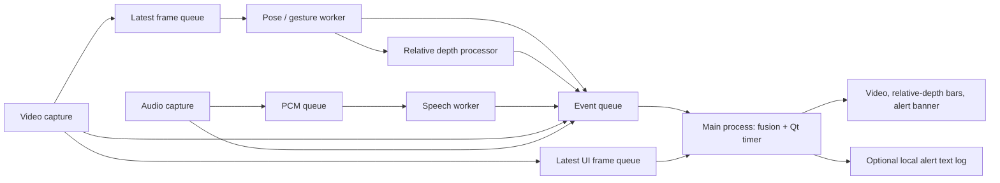

# Architecture

This is the original university team's multiprocess application, with scoped
fusion corrections, explicit backend health, and synthetic validation. It combines camera frames,
pose-based fall events, optional relative depth, and speech keywords. It displays
and can log alert text; it has no SMS provider or medical monitoring guarantee.

## Process and event flow

The main process owns the Qt application, fusion state machine, and a 50 ms
timer. Child processes communicate through bounded `multiprocessing.Queue`
objects. UI updates remain in the main thread.



There are two execution arrangements:

| Mode | Child processes | Depth handoff |
| --- | --- | --- |
| `python main.py --sim` | Video, audio, gesture, depth, speech: five | Gesture and depth read the shared synthetic scene; simulated depth does not consume pose packets. |
| `python main.py` | Video, audio, merged GPU, speech: four | The GPU worker runs real pose and optional depth sequentially in one process, constructing Su's packet inline. |

The standalone `gesture_process` and `depth_process` retain a frame-plus-bbox
queue interface for independent integration. The real application currently
selects `modules/gpu_worker.py` instead. Sharing the pose/depth CUDA context was
a historical memory-saving integration decision. Speech defaults to CPU and can
be overridden with `SPEECH_DEVICE`; no memory or throughput measurements were
made in Phase C1.

## Queues, messages, and shared controls

| Channel | Capacity / payload | Purpose |
| --- | --- | --- |
| Pose input | One BGR NumPy frame | Drop older frames to favor recent observations. |
| UI input | One BGR NumPy frame | Keep video display independent of pose inference. |
| Standalone pose-to-depth | One packet containing frame and bbox | Preserve the selected person's frame and ROI together. |
| Audio input | 32 PCM chunks | 16 kHz mono, signed 16-bit, 4,000 frames per chunk; drop an old chunk if the consumer falls behind. |
| Events | 256 dictionaries | Detection events, track boxes, and heartbeats; the main loop drains at most 100 at a time. |

The common event envelope remains:

```python
{"ts": 123.0, "source": "gesture", "type": "event", "payload": {...}}
```

`ts` is a Unix wall-clock timestamp. The defined message types are `event`,
`status`, and `detections`. Gesture events use `gesture="lay_down"`, confidence,
and optionally a frame region and normalized center. Depth events use
`depth_level`, `near_score`, and `status`. Speech events use `keyword` and
confidence. Track payloads contain pixel boxes, track state and identity, and
an observed inference cadence; the UI overlays them on the latest video.

Shared values request tracker reset and depth refresh. A three-element shared
array stores synthetic scenario start time, forced fall, and forced help.
`annotated_active` and `gesture_ready` remain historical standalone-interface
controls; the current real main path does not use separate model-loading
coordination or annotated-frame transport.

### Worker activity and backend health

The status payload is an additive extension of the original event contract:

```python
{"state": "alive", "health": "unavailable", "backend": "opencv",
 "module": "video", "reason": "camera_open_failed"}
```

`state="alive"` records worker activity independently of backend operation.
`module` identifies video/audio under the shared `system` source. `backend` and
optional `reason` use fixed descriptions, rather than exception text or local
paths. Health values have the following meanings:

| `health` | Meaning / UI label |
| --- | --- |
| `initializing` | Backend setup is beginning; `INITIALIZING`. |
| `ready` | Sensor has produced real data, or the model initialized / last operation succeeded; `READY`. |
| `simulated` | Explicit synthetic mode; `SIMULATION`. |
| `degraded` | A runtime operation failed, or a functional fallback backend is in use; `DEGRADED`. |
| `unavailable` | Required dependency, device, or model could not initialize / provide data; `UNAVAILABLE`. |
| `disabled` | Optional real depth was not requested; `DISABLED`. |

Transitions emit immediately; unchanged health repeats nominally every two
seconds, paced with a monotonic clock. Full event queues drop statuses instead
of blocking producers, and subsequent heartbeats retry delivery. Health
messages retain the wall-clock `ts` used by the original envelope. The UI
records a separate monotonic receipt time and displays `STALE - last ...`
after at least five seconds without a received status. It displays `WAITING`
before the first status and `ALIVE (health unknown)` for legacy status payloads
without the extension. Backend/reason details are visible next to the label.

Health records a module's last report, rather than detection quality or the
freshness of upstream observations. An initialized recognizer can be ready
while audio is unavailable. Long synchronous inference can delay heartbeats,
and receipt age is not capture age. Status does not change fusion rules.
Bounded queues remain best-effort transport, not durable messaging.

### Sensor failures and recovery

In real mode no synthetic frames or fabricated silent PCM are queued after
capture failure. Camera and microphone readiness requires a successful read,
rather than device open alone. Missing dependencies, failed open, or failed
read before any good data report `unavailable`. A failed read after successful
capture reports `degraded`. Failed handles are released, and capture workers
attempt initialization again after at least two seconds using monotonic time.
A successful read returns to `ready`; a failed reopen reports `unavailable`.
Console messages occur on state transitions rather than on every failed read.
The UI can retain the last genuine frame while its video status reports failure.

Only `--sim` intentionally produces scripted frames and silent PCM. The retry
mechanism applies after a driver returns an error; it cannot bound a stalled
blocking read. Actual reconnection and shutdown behavior still need hardware
validation.

## Pose and fall detection: Song

`modules/song/fall_detector.py` implements keypoint feature extraction, greedy
multi-person matching, EMA keypoint smoothing, and per-track
`NORMAL → FALLING → FALLEN` transitions. It requires a recent downward head
motion and a horizontal posture indicated by bbox aspect ratio or torso tilt,
then confirms that posture for a configured duration. Its standalone entry
point supports OpenCV rendering, stdout JSON, and optional UDP JSON output.
The integrated app uses the tracker as a library and does not invoke its UDP
sender.

`modules/gesture_song.py` adapts the detector to the team message contract.
It selects a freshly updated fallen track for depth when available, otherwise
the largest fresh person. The wrapper supplies recovery tuning and a 25-second
automatic tracker reset. Its reported event confidence is a fixed integration
value, not a measured probabilistic fall confidence.

Real pose requires CUDA, PyTorch, torchvision, Pillow, `trt_pose`, `torch2trt`, a
compatible topology JSON, and locally supplied weights or a matching TensorRT
engine. Missing real models leave the worker alive with `unavailable` health rather
than generating synthetic fall events. Initialization is attempted once per
worker start; correcting dependencies or artifacts requires a restart. A
runtime inference failure reports `degraded`, keeps the process alive, and
permits another attempt on a later frame; success restores `ready`. Check [MODELS.md](MODELS.md) for artifact and rights
requirements.

## Relative depth and pose-to-depth integration: Su

`DepthEstimator` wraps Depth Anything V2 Small, infers a relative depth map,
clips the person bbox, removes a margin around the ROI, trims extreme values,
and takes the median. Its near score normalizes that value against the current
image's depth percentiles. It is scene-relative and has no meter calibration.

`DepthProcessor` validates frame and bbox, smooths the near score with an EMA,
and classifies it into `FAR`, `MIDDLE`, or `NEAR`. Defaults inherited from the
team implementation are alpha 0.25 and class boundaries 0.5142 / 0.8364.
They have not been calibrated or validated against real scenes in Phase C1.
No target clears target-dependent smoothing and skips inference. An injected
estimator allows the control logic to run without PyTorch or checkpoints.

`DepthIntegrationAdapter` validates protocol version 1, frame ID, finite
timestamps, bbox, and optional confidence. Its packet fields are `frame`,
`frame_id`, `captured_at`, `bbox`, `pose_inferred_at`, `pose_confidence`, and
`track_id`. It rejects stale packets using a default 1,000 ms age limit, skips
inference without a target, and resets smoothing when a known track changes.
Packet timestamps use `time.monotonic()`, separate from event wall-clock time.

Real depth is disabled unless `--depth` is supplied. When enabled it runs on a
fall or after the idle refresh period, default 20 seconds, with app input size
154. The standalone depth library has its own default input size 224. The
historical source reports conflicting latency figures; none were remeasured.
Inline depth inference pauses pose processing in the merged GPU worker.
Depth reports `disabled` without `--depth`, even when pose cannot initialize.
With depth requested, a missing pose backend is `unavailable` with reason
`pose_unavailable`; depth initialization failure is also `unavailable`. Stale
packet or inference failure is `degraded`, with another attempt on the next
scheduled or requested packet. A no-target
result is valid and does not mark the backend failed. Later successful
processing restores `ready`; initialization failures require restart.

The existing producer assigns `captured_at` when constructing the packet
after pose inference, rather than at camera capture. GPU frame IDs also wrap
instead of increasing forever. The adapter's age and latency fields therefore
do not measure complete camera-to-inference delay. These limitations remain
for a hardware integration phase.

## Speech keyword recognition: Huo

The primary implementation loads a two-class ResNet-18 state dictionary for
`hello` / `help`. Huo's `AudioFeatureExtractor` computes a torch STFT, mel
filterbank, normalized log-mel spectrogram, and a 224-by-224 image repeated
into three channels. The streaming wrapper buffers 2.5 seconds of PCM, attempts
inference after a one-second hop, applies an RMS energy gate and confidence
threshold, and suppresses repeated detections with a cooldown.

Default gate 0.006 and confidence 0.50 derive from historical comments, not a
new accuracy study. They are overridable through `SPEECH_ENERGY_GATE` and
`SPEECH_CONF`. A two-class classifier has no trained background/noise class;
energy gating is only a heuristic. Historical speaker and training-data claims
are not independently verifiable from this source-only archive.

An optional locally installed Vosk recognizer is attempted when the Huo model
cannot load. It searches final and partial transcript text for `help`, `aide`,
or `tasukete` and assigns fixed event confidences. This uses substring matching
and can repeat partial-result events. Vosk is labeled `degraded` with a fallback reason even when it is functional,
so it cannot appear as the intended Huo backend. Missing both real recognizers
leaves speech alive with `unavailable` health. Initialization failures require
restart after correcting the local setup. Runtime inference failures retain
the process and report `degraded`; later successful input processing restores
`ready` for Huo or the fallback `degraded` state for Vosk. Simulation emits
scripted help independently of audio.

## Fusion, presentation, and simulation

Fusion records usable relative depth and the detected frame region for alert
text. Depth supplies context; it is not required to escalate the alert. A
confirmed fall enters L1. A speech keyword in `help`, `aide`, or `tasukete`
with finite numeric confidence from 0.50 through 1.0 can enter L2 if its
timestamp is from zero through ten seconds after the original fall timestamp.
Unrelated or invalid-confidence speech is ignored. Explicit fall/help
timestamps that are nonnumeric, boolean, `None`, or nonfinite are ignored; an
omitted timestamp retains the historical receipt-time default. Active
incidents reject falls timestamped before their first fall. Duplicate fall
events refresh activity without lowering severity or restarting that window;
an older duplicate cannot overwrite the region from a newer fall. Valid later help can refresh an active alert without escalating it.

An alert expires strictly after 30 seconds of qualifying inactivity. Expiration
is checked against the receipt clock before accepting a new event, so an
expired alert cannot be revived by a queued keyword. Reset and timeout clear
fall-specific region context while retaining the latest usable relative depth;
that retained depth has no freshness guarantee. Fall/help events emitted at or
before a manual reset are ignored. Automatic expiration uses the inactivity
deadline as the event cutoff, allowing a fresh fall delayed in transit to start
a new incident. Fusion accepts an optional
clock for deterministic testing; normal execution continues using wall-clock
time. Wall-clock adjustments can still expire alerts early or delay expiration;
no production clock conversion was introduced. [TESTING.md](TESTING.md)
describes the retained Phase C1 regressions and Phase C2 timing corrections.

The UI contains a video panel with track boxes, three relative-depth bars,
an alert banner, and heartbeat status. It has no geographic map, reconstructed
3D position, or metric distance display. A region such as `center-bottom`
describes a portion of the camera frame. Alert text can be appended to a local
tab-separated log; no outbound SMS or emergency dispatch is implemented.

The shared synthetic scene repeats every 45 seconds: walking until 10 seconds,
fallen after 10 seconds, and helping after 13 seconds. Near score, frame drawing,
and event production share that scene. It exercises message flow and fusion,
not trained model accuracy. In the UI, F/H force synthetic fall/help while
running `--sim`; R resets fusion and requests tracker reset. F/H do not inject
real sensor detections in hardware mode.

## Validation boundaries

Synthetic tests can run without Qt, sensors, CUDA, third-party model frameworks,
or checkpoints. GUI simulation additionally needs PyQt5 and NumPy. Hardware
capture and all trained inference remain unverified on an actual Jetson Nano.
The historical target is JetPack 4.6.x, CUDA 10.2, Python 3.6.9, and a compatible
Jetson PyTorch stack; modern PC tests do not establish that compatibility.

Sensor and model failure tests use mocked dependencies, with no real camera,
microphone, or trained inference. Sensor availability, recognition quality,
queue pressure, complete timestamps, prolonged recovery, and device failure
reporting need actual hardware testing before any deployment. This remains a team research/demo
project, without a reliability or physical safety claim.
